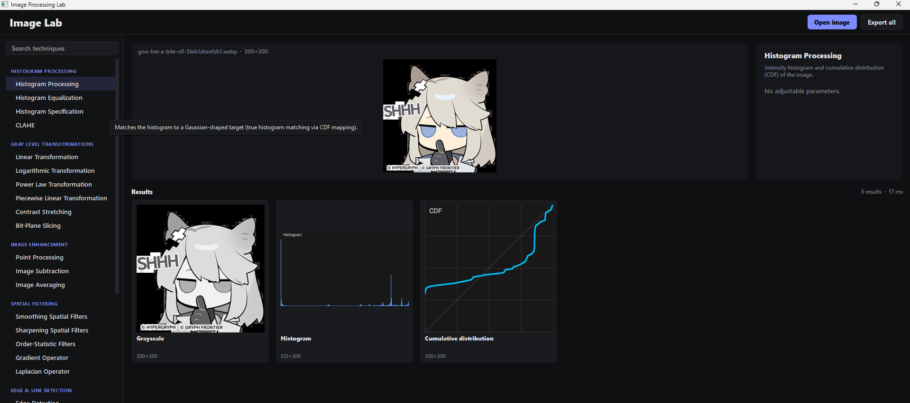
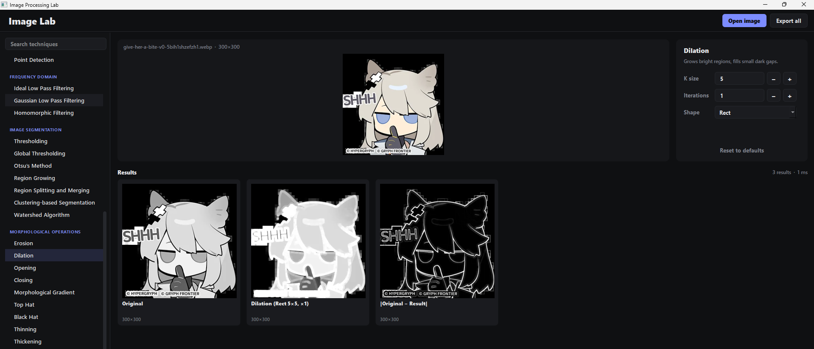

<div align="center">

# Image Lab

**A desktop playground for classic image processing techniques.**


 

### [⬇ Download for Windows (no setup needed)](https://github.com/Sudhanva-K-Upadhya/Image-processing-/releases/latest)

</div>

---

## Quick start

```bash
pip install PyQt5 opencv-contrib-python numpy
python image_lab.py
```

Open an image (or drag and drop one), pick a technique from the sidebar, and adjust its parameters. Results update automatically.

## Features

- **50+ techniques** in 11 categories, each with adjustable parameters
- **Side-by-side results**, click any card to zoom
- **Live webcam detection** (ArUco, motion, anomaly) right in the main window
- **Export** all results at once, or save a single webcam frame
- Dark, clean UI that scales to your screen

## Techniques

| Category | Includes |
|---|---|
| Histogram Processing | Equalization, Specification, CLAHE |
| Gray Level Transformations | Linear, Log, Power Law, Piecewise, Contrast Stretching, Bit-Plane Slicing |
| Image Enhancement | Point Processing, Subtraction, Averaging |
| Spatial Filtering | Smoothing, Sharpening, Order-Statistic, Gradient, Laplacian |
| Edge & Line Detection | Sobel / Prewitt / Roberts, Canny, Hough Lines, Point Detection |
| Frequency Domain | Ideal LPF, Gaussian LPF, Homomorphic |
| Image Segmentation | Thresholding, Otsu, Region Growing, Split & Merge, K-Means, Watershed |
| Morphological Operations | Erosion, Dilation, Opening, Closing, Thinning, Convex Hull, Hole Filling |
| Boundary & Shape | Edge Linking, Boundary Detection, Polygon Fitting, Shape Detection |
| Color & Vision | Gaussian Blur, Color Conversion, Color Masking, Perspective Transform |
| Live Video | ArUco Marker, Motion, and Anomaly Detection |

## Build an .exe (Windows)

Put `image_lab.py`, `icon.ico` and `build_exe.bat` in one folder and run the batch file. The app is created at `dist\ImageLab.exe`.

## Built with

[OpenCV](https://opencv.org/) · [NumPy](https://numpy.org/) · [PyQt5](https://pypi.org/project/PyQt5/)

## Project structure

```
image_lab.py     # the application
icon.ico         # app icon
build_exe.bat    # builds the Windows exe
```

## License

MIT
